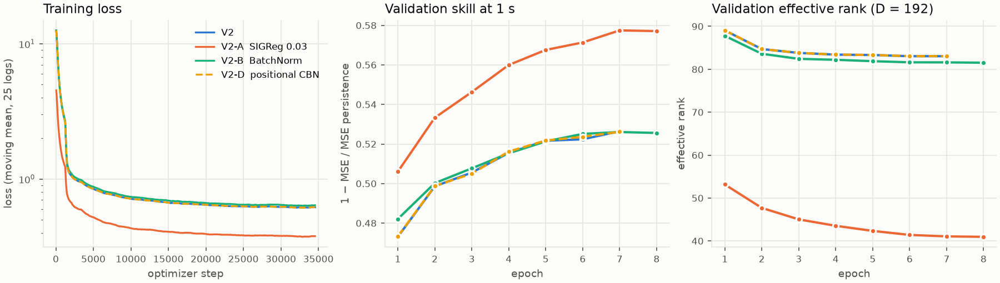
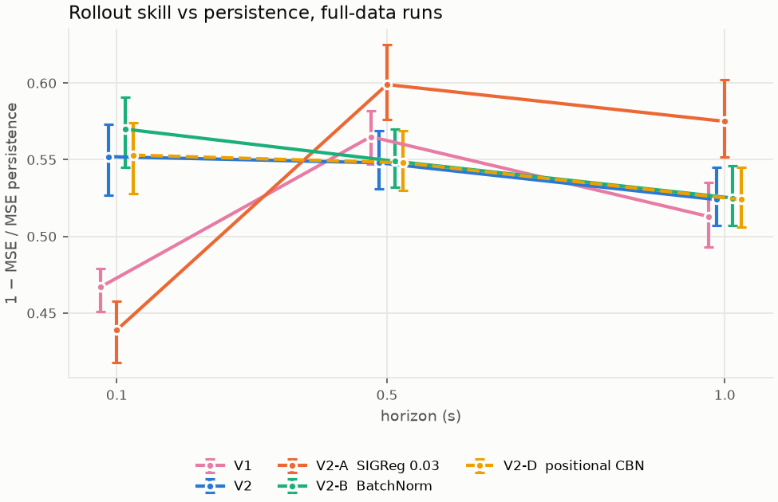
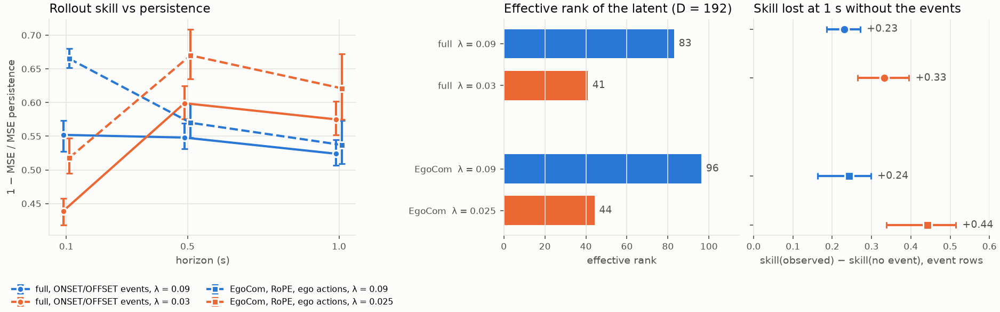

# World model for conversational turn-taking

A JEPA-style latent world model for multi-party turn-taking in social robots.
A frozen encoder (Mimi by default) turns the recording into latent
observations, and an action-conditioned causal predictor learns how the
conversational state evolves. Its rollouts are meant to serve a downstream
planner deciding when the robot should speak, wait or yield the floor.

[Training design](docs/training.md) · [research program](docs/research_program.md) ·
[decisions](docs/decisions/README.md) · [data pipeline](https://github.com/batgr/world-model-turn-taking-data)

## Data

Runs load a Hugging Face release listed in `turn_wm.data.source.DATASETS`
(`data.dataset`): `egocom` (public), `ego4d` and `full` (private, both corpora)
on a 10 Hz grid, and `egocom_12.5hz`, `ego4d_12.5hz`, `full_12.5hz` on a
12.5 Hz grid, one step per Mimi frame (train them with `data.grid_rate_hz=12.5`).
A split includes only the corpora that publish it.

## Configuration

[Hydra](https://hydra.cc) composes `configs/config.yaml` from one model and one
training recipe:

```text
configs/
  config.yaml       embed_dim; defaults: model, train
  model/lewm*.yaml  the JEPA and its sub-modules (_target_)
  model/encoder/    the frozen encoder (mimi, logmel) and the feature_dim it gives
  train/lewm*.yaml  seed, data, prediction, loss, optimizer, loader, trainer
```

The recipe sits at the root of the composed config (`cfg.trainer.max_epochs`,
`cfg.loss.sigreg.weight`). `train=lewm_v2` is the current recipe; each
`model=lewm_*` variant changes one component of the default model.

## Training

The encoder is frozen, so its features are computed once per dataset:

```bash
uv run turn-wm precompute-features --encoder mimi --dataset egocom_12.5hz \
  --media-root /path/to/EgoCom --output /path/to/cache --device cuda
```

`--media-root` takes `DATASET=PATH` once per corpus for `full`; trailing Hydra
overrides configure the encoder (e.g. `model.encoder.revision=<sha>`). Then
train on the cache, with any Hydra override:

```bash
uv run turn-wm train train=lewm_v2 data.dataset=egocom_12.5hz data.grid_rate_hz=12.5 \
  data.feature_cache.root=/path/to/cache loader.batch_size=16
```

`data.observation_source=raw_audio` encodes the media during training instead,
for debugging; it reads `<DATASET>_MEDIA_ROOT` (e.g. `EGOCOM_MEDIA_ROOT`).
A configuration rejected by `validate_config` fails before any data is read.
[docs/training.md](docs/training.md) covers the objective, the curriculum,
the encoders and the cache.

### Runs

Each run gets a directory, created once the configuration, the dataset and
the media roots have been checked:

```text
outputs/<experiment.name>/<UTC timestamp>-<config hash>/
  config.yaml      the resolved configuration
  metadata.json    seed, git commit and dirty flag, host, dataset revision, resumptions
  train.log        Lightning's messages (validation verdicts, resumption, warnings)
  tensorboard/     losses, LR, throughput
  fit-profile.txt  time per training hook (e.g. train_dataloader_next: waiting for data)
  checkpoints/     best checkpoints by checkpoint.monitor, and last.ckpt
```

```bash
uv run tensorboard --logdir outputs/
uv run turn-wm train --restore outputs/lewm/<run id>     # resume in place
uv run turn-wm train checkpoint.resume_from=<ckpt>        # new run from these weights
```

Weights & Biases is optional: `uv sync --extra wandb`, then
`logging.wandb.enabled=true logging.wandb.entity=<entity>`.

## Experiments

Audio-only, frozen Mimi, 10 Hz. One seed per run, validation split only (the
test split stays closed). Skill = 1 − MSE / MSE of persistence
(z_(t+h) = z_t) for the autoregressive rollout, which feeds back its own
predictions; intervals are 95% bootstraps over recordings.

| run | data | change | analysed checkpoint |
|---|---|---|---|
| V1 | full (EgoCom + Ego4D) | first recipe: C=15, batch 128, 10k steps | `step 9000` |
| V2 | full | C=W=30, H=10, batch 512, ≤ 8 epochs (`train=lewm_v2`) | `epoch=006` |
| V2-A | full | V2 with SIGReg 0.09 → 0.03 | `epoch=006` |
| V2-B | full | V2 with BatchNorm instead of CausalBN | `epoch=006` |
| V2-D | full | V2 with per-position CausalBN in the projector | `epoch=006` |
| EgoCom λ=0.09 / 0.025 | EgoCom | RoPE predictor, WAIT/START/HOLD/STOP ego actions, SIGReg 0.09 vs 0.025 | `epoch=002` / `epoch=003` |

### Training



Validation skill at 1 s plateaus by epoch 7; V2-A is ahead from the first
epoch, with half the effective rank. V2-A's loss is lower partly because its
SIGReg term weighs less, so losses are not comparable across SIGReg weights.
V2 and V2-D overlap.

### The world model beats persistence up to 1 s



Every run beats persistence at every horizon (skill 0.44–0.60). Going from V1
to V2 raises skill at 0.1 s (0.47 → 0.55) and leaves 1 s unchanged; V1 and V2
differ in several settings, so this is not attributed to the context length.
BatchNorm (V2-B) and per-position statistics (V2-D) change nothing beyond the
intervals: the projector normalization does not matter here.

### SIGReg sets a trade-off, in two different setups



Lowering the SIGReg weight has the same three effects on the full data with
ONSET/OFFSET events and on EgoCom with RoPE and explicit ego actions:

- skill drops at 0.1 s and rises at 0.5–1 s;
- the latent's effective rank halves (83 → 41, 96 → 44);
- the rollout relies more on the future events: replacing them by "no event"
  (or by WAIT/HOLD) costs more skill (+0.23 → +0.33, +0.24 → +0.44).

The cost shows across corpora. With λ = 0.03 the latent separates EgoCom from
Ego4D more (dataset silhouette 0.040 → 0.067), and a probe for "others
active" trained on EgoCom and tested on Ego4D falls further below the Mimi
features (−0.03 → −0.07 balanced accuracy). λ is therefore a choice between
local accuracy and domain robustness on one side, long-horizon,
event-driven dynamics on the other, to be settled by a sweep.

### What the latent is, and is not, yet useful for

- **It keeps the encoder's information.** Linear probes read the current
  conversational state (ego speaking, others active, joint state) from the V2
  latent as well as from Mimi (balanced accuracy within 0.012).
- **It does not yet add to it.** On TurnBench DEV, matched heads on each
  representation, with thresholds at ≤ 10% false positives, give:

  | task | Mimi | V1 latent z_t | V1 one-step prediction |
  |---|---:|---:|---:|
  | end of turn: recall · p50 latency | 0.595 · 1444 ms | 0.590 · 1559 ms | 0.536 · 1696 ms |
  | interruption: recall · p50 latency | 0.553 · 291 ms | 0.484 · 316 ms | 0.481 · 267 ms |

  Single operating points without intervals; V1 predates the V2 changes.

- **Rollouts are cheap.** The EgoCom λ=0.09 predictor rolls out
  1 s (10 steps) in 85 ms for one candidate and 93 ms for 128 candidates
  (p50, NVIDIA L4, bf16, encoding excluded).


## Tests

```bash
uv run pytest                  # offline unit tests
uv run pytest -m integration   # downloads EgoCom (and Mimi) from the Hub
```

Raw-media smoke tests also need `EGOCOM_MEDIA_ROOT` or `EGO4D_MEDIA_ROOT`.
